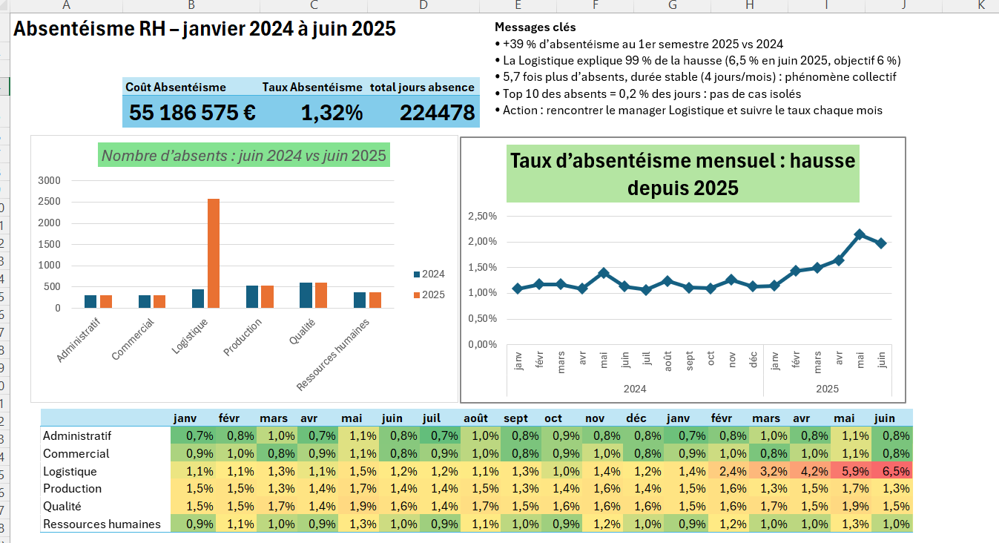

# Analyse de l'absentéisme RH – Excel, Power Query et Power Pivot

Projet d'analyse de données réalisé dans **Excel** (Power Query, Power Pivot, DAX) sur des données RH de suivi mensuel : environ **47 700 collaborateurs**, **6 services**, de **janvier 2024 à juin 2025** (814 428 lignes).

L'objectif : répondre à **5 questions d'un manager RH** qui constate une hausse des absences, puis formuler des **recommandations concrètes**.



---

## Données et préparation

- **18 fichiers CSV mensuels** combinés automatiquement avec Power Query (connexion à un dossier) : un nouveau mois se charge par simple actualisation.
- **Nettoyage :** correction d'un type mal détecté (« 01 - Janvier » converti à tort en date 2026), suppression des colonnes inutiles, conversion des dates d'entrée et de départ.
- **Contrôle qualité sur toutes les lignes :** 0 % d'erreurs et de valeurs vides, 18 mois, 6 services, aucun doublon (collaborateur × mois).
- **Point d'attention :** la colonne « Collaborateur » ne contenait que 120 noms pour 47 694 personnes. Toute l'analyse se fait donc par **identifiant**, jamais par nom.

## Modèle de données (schéma en étoile)

| Table | Rôle | Lignes |
|---|---|---|
| `Faits_Absences` | Table de faits : jours théoriques et jours d'absence par collaborateur et par mois | 814 428 |
| `Dim_Collaborateur` | Dimension : nom, dates d'entrée et de départ, coût journalier | 48 596 |
| `Dim_Service` | Dimension : service, direction, manager, objectif d'absentéisme | 6 |

**Mesures DAX :**

```
Taux Absentéisme        = DIVIDE([Total Jours Absence]; [Total Jours Théoriques])
Nb Collaborateurs Absents = CALCULATE(DISTINCTCOUNT(Faits_Absences[ID collaborateur]); Faits_Absences[Jours absence] > 0)
Jours par Absent        = DIVIDE([Total Jours Absence]; [Nb Collaborateurs Absents])
Coût Absentéisme        = SUMX(Faits_Absences; Faits_Absences[Jours absence] * RELATED(Dim_Collaborateur[Coût journalier chargé]))
```

---

## Questions et résultats

### Q1 – Quel est le niveau global, et respecte-t-il l'objectif ?

Le taux global est de **1,32 %**, bien sous les objectifs des services (5 à 6 %), pour un coût de **55,2 M€** sur 18 mois. Mais à semestre égal, il passe de **1,17 % (janv.–juin 2024) à 1,63 % (janv.–juin 2025), soit +39 %**.

### Q2 – Comment évolue-t-il dans le temps ?

Stable en 2024 (entre 1,07 % et 1,40 %), il **augmente chaque mois depuis janvier 2025**, de 1,15 % à **2,14 % en mai**. Ce n'est pas un pic ponctuel, mais une tendance.

### Q3 – Quels services sont touchés, et lesquels dépassent leur objectif ?

La **Logistique explique à elle seule 99 % de la hausse** des jours d'absence (+25 134 jours sur +25 323). Les cinq autres services restent stables. Son taux mensuel est passé de **1,45 % en janvier à 6,49 % en juin 2025**, au-dessus de son objectif de 6 %.

> Une moyenne semestrielle (3,91 %) aurait masqué ce dépassement : l'analyse mois par mois était indispensable.

### Q4 – Absences courtes et répétées, ou longues absences ?

Dans la Logistique, le nombre d'absents passe de **452 (juin 2024) à 2 570 (juin 2025)**, soit **5,7 fois plus**, alors que chaque absent manque toujours **environ 4 jours par mois**. La hausse vient d'absences courtes qui touchent beaucoup plus de personnes : c'est un **phénomène collectif**.

### Q5 – Quels collaborateurs concentrent le plus d'absences ?

Les 10 collaborateurs les plus absents ne représentent que **0,2 %** des jours d'absence (480 sur 224 478). Les absences sont réparties sur un grand nombre de personnes, ce qui confirme la Q4.

---

## Recommandations

1. **Rencontrer le manager de la Logistique** pour identifier ce qui a changé fin 2024 – début 2025 (charge de travail, horaires, organisation, effectifs).
2. **Mener une enquête courte** auprès des équipes logistiques.
3. **Suivre chaque mois** le taux de la Logistique, qui a dépassé son objectif en juin 2025.

## Limites

- Les données s'arrêtent en juin 2025 : on ne sait pas si la hausse s'est poursuivie.
- Les motifs d'absence ne sont pas disponibles : les causes proposées restent des **hypothèses** à vérifier sur le terrain.
- Données RH fictives, issues d'un jeu de données pédagogique ; elles sont incluses dans le modèle de données du fichier Excel.

## Fichiers

- `Analyse_Absenteisme_RH.xlsx` : le classeur complet (requêtes Power Query, modèle Power Pivot, mesures DAX, analyses Q1 à Q5, dashboard)
- `dashboard.png` : capture du dashboard
- `README.md` : ce document

## Compétences mobilisées

Power Query (combinaison de fichiers, typage, contrôle qualité) · Power Pivot (modèle en étoile, relations) · DAX (CALCULATE, DISTINCTCOUNT, SUMX, RELATED, DIVIDE) · tableaux et graphiques croisés dynamiques · mise en forme conditionnelle · dashboard · restitution orientée décision.

---

**Auteur :** Christian Nguemewe – Junior Data Analyst
[LinkedIn](https://www.linkedin.com/in/christian-nguemewe)
